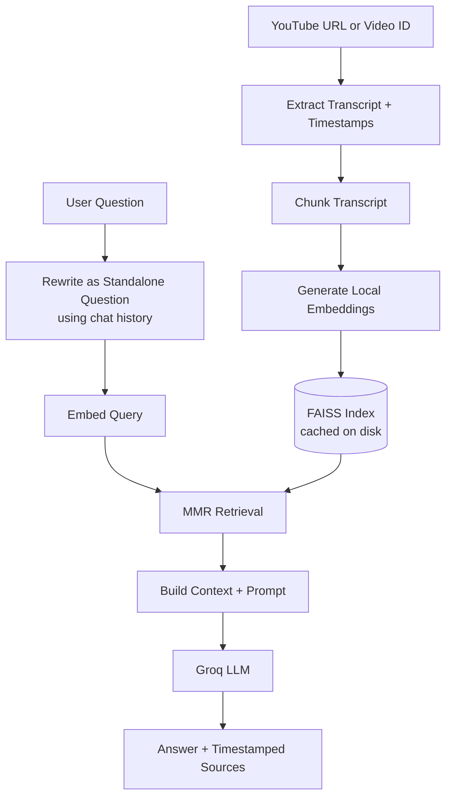

# 🧠 VidQuery

### Don't just watch. Understand.

**VidQuery is an AI video knowledge assistant that turns YouTube videos into searchable knowledge.** Paste a link, ask questions in plain English, and jump straight to the moments in the video that support each answer.

Built with LangChain, HuggingFace embeddings, FAISS, Groq, and Streamlit using a Retrieval-Augmented Generation (RAG) pipeline.

## Overview

Long YouTube videos are time-consuming to watch, and hard to search. VidQuery solves this by letting you talk to a video.

Instead of relying on an LLM's pretrained knowledge, VidQuery retrieves the most relevant sections of the video's transcript and uses them as context. Answers stay grounded in what the video actually says, and every answer links back to timestamped sources.

## Features

- **Transcript Extraction:** Fetches English captions with `youtube-transcript-api` and keeps a mapping between transcript text and video time.
- **Flexible Input:** Accepts standard YouTube URLs (`watch`, `youtu.be`, `embed`, `shorts`, `live`) or a bare 11-character video ID.
- **Smart Chunking:** Splits transcripts with LangChain's `RecursiveCharacterTextSplitter`, with adjustable chunk size and overlap.
- **Local Embeddings:** Generates vectors on your machine with `all-MiniLM-L6-v2`. No embedding API is needed.
- **FAISS Vector Search:** Stores and retrieves transcript chunks efficiently.
- **MMR Retrieval:** Uses Maximal Marginal Relevance to return chunks that are both relevant and diverse.
- **Conversational Follow-ups:** Rewrites follow-up questions into standalone queries, so "what about the second one?" works as expected.
- **Grounded Answers:** The model is instructed to answer only from the transcript, and to say *"I couldn't find that in this video"* when the answer isn't there.
- **Timestamped Sources:** Every answer comes with expandable source chunks and clickable `mm:ss` links that open the video at that moment.
- **Full Video Summary:** Optional map-reduce summary across every transcript chunk.
- **Persistent Index Caching:** Saves FAISS indexes locally and reuses them when the transcript and configuration match.
- **Developer Insights:** Inspect chunks, FAISS vector mapping, the rewritten query, query embedding, similarity candidates, MMR selections, the LLM context, and the full prompt.
- **Adjustable Pipeline:** Tune the models, chunking, retrieval, and temperature from the sidebar.

## Tech Stack

| Category | Technology |
|---|---|
| Language | Python |
| Frontend | Streamlit |
| LLM Framework | LangChain |
| LLM Inference | Groq |
| Language Model | `openai/gpt-oss-20b` (configurable) |
| Embedding Model | `sentence-transformers/all-MiniLM-L6-v2` (configurable) |
| Vector Database | FAISS |
| Transcript Extraction | youtube-transcript-api |
| Environment Variables | python-dotenv |

## Architecture



## How It Works

### 1. Transcript Extraction
VidQuery fetches English captions for the video and records where each caption snippet begins in the full transcript text. This lets every chunk be mapped back to a video timestamp later.

### 2. Chunking
The transcript is split into overlapping chunks. Each chunk stores metadata: video ID, chunk ID, start time, and a deep link to that moment in the video.

### 3. Embedding and Indexing
Chunks are embedded locally with `all-MiniLM-L6-v2` and stored in a FAISS index. The index is saved to disk alongside a manifest, so revisiting the same video skips the embedding step.

### 4. Question Rewriting
For follow-up questions, the LLM rewrites the latest message into a standalone question using the recent conversation history. First questions are passed through unchanged.

### 5. Retrieval
The standalone question is embedded and FAISS returns a candidate pool. MMR then selects the final chunks, balancing relevance and diversity according to the `lambda` setting.

### 6. Answer Generation
The selected chunks, with their timestamps, and the conversation history are combined into a prompt. The Groq-hosted model answers using only that context, and the sources are displayed beneath the answer.

## Project Structure

```text
vidquery/
│
├── app.py                  # Streamlit application
├── requirements.txt        # Python dependencies
├── .env                    # GROQ_API_KEY (not committed)
├── .gitignore
│
├── faiss_indexes/          # Auto-created. Cached FAISS indexes + manifests
│
└── README.md
```

## Installation and Setup

### Prerequisites

- Python 3.10 or higher
- Git
- A [Groq API key](https://console.groq.com/)
- An internet connection

### 1. Clone the Repository

```bash
git clone https://github.com/SonuSk584/VidQuery.git
cd vidquery
```

### 2. Create a Virtual Environment

**macOS / Linux:**

```bash
python -m venv venv
source venv/bin/activate
```

**Windows PowerShell:**

```powershell
python -m venv venv
.\venv\Scripts\Activate.ps1
```

If PowerShell blocks script execution:

```powershell
Set-ExecutionPolicy -Scope Process -ExecutionPolicy Bypass
```

Then activate the environment again.

### 3. Install Dependencies

```bash
python -m pip install -r requirements.txt
```

The app relies on `streamlit`, `python-dotenv`, `youtube-transcript-api`, `langchain-core`, `langchain-text-splitters`, `langchain-community`, `langchain-huggingface`, `langchain-groq`, `faiss-cpu`, and `sentence-transformers`.

### 4. Configure Environment Variables

Create a `.env` file in the project root:

```env
GROQ_API_KEY=your_groq_api_key
```

> **Important:** Never commit your `.env` file or expose your API key. Restart the app after changing it.

### 5. Run VidQuery

```bash
streamlit run app.py
```

Open [http://localhost:8501](http://localhost:8501) in your browser.

## Usage

1. Launch the app.
2. Paste a YouTube link and click **Process video**.
3. Wait while the transcript is read and the search index is created (or reused).
4. Ask questions in the chat. Follow-up questions work naturally.
5. Open **Sources from this video** under any answer and click a timestamp to jump to that moment.
6. Optionally, generate a **full video summary**.
7. Open **Developer insights** to inspect the RAG pipeline.

## Configuration

Open the sidebar and expand **Advanced pipeline settings**.

| Setting | Default | Description |
|---|---|---|
| Groq model | `openai/gpt-oss-20b` | LLM used for answers, rewriting, and summaries |
| Embedding model | `sentence-transformers/all-MiniLM-L6-v2` | Local embedding model |
| Chunk size | 800 | Characters per transcript chunk |
| Chunk overlap | 120 | Characters shared between neighboring chunks |
| Retrieved chunks | 5 | Chunks passed to the LLM |
| MMR candidate pool | 15 | Candidates considered before MMR selection |
| MMR relevance/diversity | 0.7 | `1.0` is pure relevance, `0.0` is maximum diversity |
| LLM temperature | 0.0 | Higher values give more varied answers |

The sidebar also has **Clear chat** and **Reset video** buttons.

> Changing the embedding model, chunk size, or overlap builds a new index for that video.

## Caching and Performance

Embedding is the slowest part of processing a video. VidQuery avoids repeating it:

- Each index is saved in `faiss_indexes/` with a `manifest.json`.
- The cache key is a hash of the video ID, transcript content, embedding model, chunk size, and chunk overlap.
- If any of these change, a new index is built. If they all match, the saved index is loaded instantly.
- Damaged or incompatible caches are detected and rebuilt automatically.

> **Security note:** FAISS indexes are loaded with `allow_dangerous_deserialization=True`. This is safe only because the app loads indexes it created itself. Never place indexes from untrusted sources in `faiss_indexes/`.

## Known Limitations

- **YouTube IP restrictions:** YouTube may block transcript requests from some IPs, especially cloud-hosted ones. This works reliably on a local machine but can fail when deployed.
- **English captions only:** Videos without English captions can't currently be processed.
- **Transcript availability:** Some videos have captions disabled.
- **Answer quality:** Answers depend on the quality of the transcript and the retrieved chunks. Auto-generated captions can contain errors.
- **API dependency:** Answers and summaries need a valid Groq API key. Processing a video does not.
- **Summary cost:** Summarizing long videos makes many LLM calls and can take a while.
- **Cache growth:** Saved indexes are not removed automatically. Delete old folders in `faiss_indexes/` to free space.

## Troubleshooting

### `RequestBlocked` / `IpBlocked`
YouTube is rejecting requests from your IP address. Wait and retry, avoid repeatedly requesting the same video (the index cache helps), or try a different network.

### "Add your Groq API key" warning
Make sure `.env` exists in the project root, contains `GROQ_API_KEY=...`, and that you restarted the app after creating it.

### "Couldn't process this video"
Check that the link is valid and the video has English captions.

### Model or dependency errors
Confirm your virtual environment is active, reinstall dependencies, and verify that the selected Groq model is available to your account.

## Security

- API keys are read from environment variables and never hardcoded.
- Keep `.env` and `faiss_indexes/` out of version control (add both to `.gitignore`).
- Don't load FAISS indexes from untrusted sources.

## Roadmap

- Multi-video chat and cross-video search
- Support for other caption languages and translated transcripts
- Relevance threshold to skip the LLM when nothing relevant is found
- Streaming responses
- Hybrid search (semantic + keyword) and reranking
- Chat export and saved video library
- RAG evaluation (faithfulness, answer relevance, context precision)

## What This Project Demonstrates

- Retrieval-Augmented Generation end to end
- Transcript preprocessing and chunking with timestamp preservation
- Local semantic embeddings and FAISS vector search
- MMR retrieval and history-aware query rewriting
- Prompt construction and grounded generation
- Map-reduce summarization
- Config-aware index caching
- Building a polished AI app with Streamlit

## License

This project is intended for educational and portfolio purposes. Add a license file if you plan to distribute or reuse it under specific terms.

---

**VidQuery** · Don't just watch. Understand.

Built with Python, LangChain, FAISS, HuggingFace, Groq, and Streamlit.